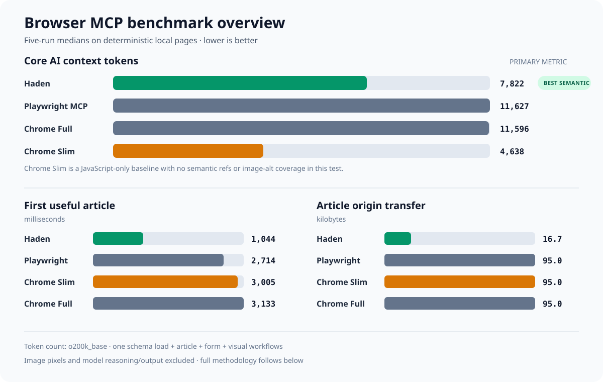
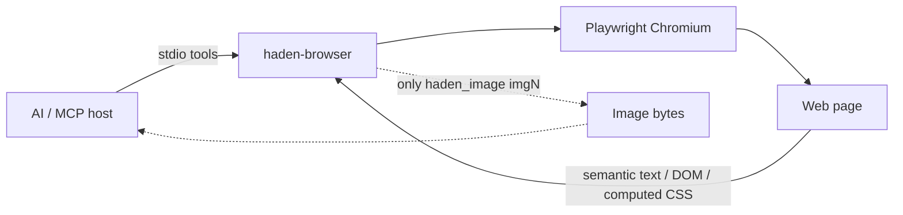

# haden-browser

`haden-browser` is a fast, AI-first web browser exposed as a local [Model Context Protocol](https://modelcontextprotocol.io/) server. It gives an AI the smallest useful page representation for its current goal instead of sending screenshots and raw page source on every turn.

## Benchmark: 33% less AI browser context

> **Primary result:** Haden used **7,822 reference tokens** for the core browsing session—**32.7% fewer than Playwright MCP** and **32.5% fewer than Chrome DevTools MCP full mode**. Among the tested browser MCPs that returned semantic action refs and image-alt coverage, Haden had the lowest token footprint.



| Five-run median | Haden | Playwright MCP | Chrome Slim† | Chrome Full |
| --- | ---: | ---: | ---: | ---: |
| Core context tokens | **7,822** | 11,627 | 4,638 | 11,596 |
| Tool-schema tokens | **727** | 3,999 | 221 | 4,974 |
| Article workflow tokens | **2,732** | 4,640 | 2,497 | 4,388 |
| First useful article | **1,044 ms** | 2,714 ms | 3,005 ms | 3,133 ms |
| Article origin transfer | **16.7 KB / 1 request** | 95.0 KB / 10 | 95.0 KB / 10 | 95.0 KB / 10 |
| Semantic action refs | 15 | 172 | 0 | 143 |
| Image-alt coverage | 8/8 | 8/8 | 0/8 | 8/8 |

† Chrome Slim is the absolute token minimum, but it is a low-level JavaScript control baseline: the model must author page scripts, and the tested path returned no semantic action refs or image alt text. It is therefore shown transparently but is not treated as a semantic-browser equivalent.

Core context includes one complete tool-schema load plus the serialized MCP tool calls and results for article reading, form submission, and computed-style inspection. Counts use the `o200k_base` tokenizer. Image pixels, user/system prompts, and model reasoning or prose are excluded, so actual billed usage depends on the MCP host and model.

See the [full benchmark report](benchmarks/results/2026-08-19.md), [raw per-run data](benchmarks/results/latest.json), and [reproduction instructions](benchmarks/README.md).

## Why it is different

- **Goal-based views** — use compact semantic text for research, sanitized DOM for structure, or bounded computed styles for visual work.
- **Images stay lazy** — an image is represented as its alt text or `[image img1]`. Pixel data is returned only when the AI explicitly calls `haden_image`.
- **Low round-trip control** — every interaction returns a fresh snapshot, so most click/type flows need one tool call per step.
- **Stable action references** — visible controls become `e1`, `e2`, and so on, which are cheaper and more reliable than asking a model to invent CSS selectors.
- **Fast by default** — image, media, and font requests are blocked during ordinary browsing. CSS remains available for the visual view.
- **Safer local execution** — non-HTTP schemes, credential-bearing URLs, and private-network targets are blocked unless the user explicitly opts in.



## Views

| View | Best for | Returned data |
| --- | --- | --- |
| `text` | Search, reading, form flows | Headings, visible text, links and controls with `e` refs, image placeholders |
| `dom` | HTML structure and attributes | Sanitized HTML; scripts and embedded content removed; `` replaced by `<haden-image>` |
| `visual` | Layout and CSS reasoning | Visible meaningful elements with boxes and a bounded set of computed CSS properties |

`text` is the default and should be preferred unless the task truly needs structure or presentation details.

## MCP tools

| Tool | Purpose |
| --- | --- |
| `haden_open` | Open an HTTP(S) URL and return its first snapshot |
| `haden_read` | Read the current page, optionally within a CSS selector |
| `haden_interact` | Click, fill, select, press, scroll, navigate history, reload, or wait; then return the updated snapshot |
| `haden_image` | Return actual image pixels for one `img` ref from the latest snapshot |
| `haden_status` | Report the active page without starting Chromium |

Example text output:

```text
# Example Domain
URL: https://example.com/
View: text
Interactive elements: 1
Images: 1 (use haden_image with an img ref only when visual inspection is needed)

# Example Domain
This domain is for use in illustrative examples.
[e1] link "More information" -> https://iana.org/domains/example
[image img1: "Example diagram"]
```

References are scoped to the latest snapshot. Read again after substantial page changes before reusing an old `e` or `img` ref.

## Requirements

- Node.js 20 or newer
- Chromium installed through Playwright

## Install from this repository

```bash
git clone https://github.com/Haden-Min/haden-browser.git
cd haden-browser
npm ci
npm run setup-browser
npm run build
```

Then configure an MCP host to launch the built stdio server. Use an absolute path in real configuration:

```json
{
  "mcpServers": {
    "haden-browser": {
      "command": "node",
      "args": ["/absolute/path/to/haden-browser/dist/index.js"]
    }
  }
}
```

During development, a host can launch `npx tsx /absolute/path/to/haden-browser/src/index.ts` instead.

After the package is published to npm, the intended configuration is:

```json
{
  "mcpServers": {
    "haden-browser": {
      "command": "npx",
      "args": ["-y", "haden-browser"]
    }
  }
}
```

Run `npx playwright install chromium` once on that machine before the first browser call.

## Configuration

| Environment variable | Default | Meaning |
| --- | --- | --- |
| `HADEN_HEADLESS` | `true` | Run Chromium without a visible window |
| `HADEN_BLOCK_HEAVY_ASSETS` | `true` | Block images, media, and fonts during normal browsing |
| `HADEN_ALLOW_PRIVATE_HOSTS` | `false` | Allow localhost and private-network destinations |
| `HADEN_NAVIGATION_TIMEOUT_MS` | `20000` | Navigation and image-fetch timeout |
| `HADEN_ACTION_TIMEOUT_MS` | `8000` | Click, fill, and locator timeout |
| `HADEN_MAX_CHARS` | `30000` | Default snapshot character limit |
| `HADEN_MAX_IMAGE_BYTES` | `5242880` | Maximum bytes returned by `haden_image` |

Boolean variables accept `true`/`false`, `1`/`0`, `yes`/`no`, and `on`/`off`.

### Local development pages

Private hosts are blocked by default to reduce SSRF risk. To browse an application on localhost, opt in for that MCP process only:

```json
{
  "mcpServers": {
    "haden-browser-local": {
      "command": "node",
      "args": ["/absolute/path/to/haden-browser/dist/index.js"],
      "env": { "HADEN_ALLOW_PRIVATE_HOSTS": "true" }
    }
  }
}
```

## Development

```bash
npm install
npm run setup-browser
npm run check
npm run build
```

The test suite covers network policy, text shaping, real Chromium extraction, ref-based interactions, lazy image retrieval, and an in-memory MCP client/server connection.

## Current limitations

- One active browser context is maintained per stdio MCP connection.
- Image refs currently cover visible HTML `` elements, not CSS background images, canvases, video frames, or iframe contents.
- The visual view reports computed properties; it does not dump every stylesheet rule.
- Downloads, file uploads, browser extensions, persistent profiles, and CAPTCHA solving are outside the MVP.
- Private-host filtering reduces SSRF exposure but is not a substitute for OS/container-level network isolation in hostile multi-tenant environments.

See [CONTRIBUTING.md](CONTRIBUTING.md) for development guidance and [SECURITY.md](SECURITY.md) for vulnerability reporting.

## License

MIT
